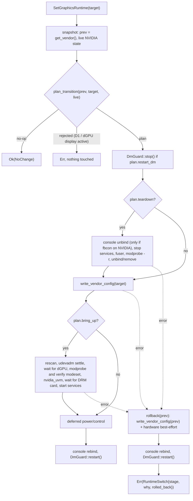

# Runtime graphics switching — fix plan & execution tracker

Scope: harden the live (no-reboot) switch `Graphics::switch_runtime`
(`src/graphics/mod.rs`) and its daemon entry point `SetGraphicsRuntime`
(`src/daemon/mod.rs`). The main focus is **integrated → hybrid / nvidia**. Most
fixes are in shared code, so they also help every other transition.

The reboot path (`Graphics::set_vendor`) keeps its current behaviour. Its only
change is the shared modprobe template change in Step 5.3.

Repo: `/home/deplague/Projects/system76-power` (HEAD `76c36a2`).
Toolchain: `devenv shell -- cargo`.

Legend: `[ ]` pending · `[~]` in progress · `[x]` done · `[!]` blocked.

---

## 0. Problem inventory

| ID | Problem | Where | Severity |
|----|---------|-------|----------|
| P1 | Any error after the display manager (DM) is stopped returns early. The DM is never restarted, the config stays half-written, and the initramfs no longer matches it. | `mod.rs` `switch_runtime` L233–307 (`?` on unbind/remove/config/rescan/modprobe) | **Critical** |
| P2 | `vtcon1` / `efifb` are unbound and never rebound. In integrated mode `vtcon1` is the **iGPU's** fbcon, so the text TTYs go blank until reboot. | `runtime.rs` `unbind_framebuffers` L51–70 | High |
| P3 | Teardown runs on every switch, even when the NVIDIA stack is not active (Integrated →). There is no "already in target mode" check either. | `mod.rs` L233–283 | Medium |
| P4 | The PCI rescan triggers a udev "add" event. udev may auto-load `nvidia`/`nvidia-drm` **without** `modeset=1` before our explicit `modprobe`. The later `modprobe nvidia-drm modeset=1` then does nothing and the parameter is silently lost. The DM may also start before the NVIDIA DRM card exists. | `mod.rs` L300–303, `runtime.rs` L114–138 | High |
| P5 | Runtime "nvidia" (Discrete) only writes an Xorg `PrimaryGPU` snippet. On Wayland (GNOME, KDE, Hyprland) the boot GPU stays primary, so the mode quietly behaves like Hybrid. | `config.rs` L175–187 | Medium |
| P6 | `nvidia_uvm` is never loaded on bring-up (CUDA needs it). | `runtime.rs` L127–136 | Low |
| P7 | The daemon mutex is held for 7 s or more while blocking `std::thread::sleep` runs on the async executor. Concurrent switch requests are not rejected. The calling client usually dies with the session, so it never gets the reply or the signals. | `daemon/mod.rs` L371–416 | Medium |
| P8 | If no DM was detected, the code still starts `gdm` anyway (`dm.unwrap_or("gdm")`). Detection only knows gdm/gdm3/sddm/lightdm, so greetd, Hyprland-from-TTY and similar setups are missed. | `mod.rs` L316, `runtime.rs` L28–38 | High |
| P9 | The external-display guard is a static list of System76 models. It (a) wrongly blocks Integrated → X, which is safe because the dGPU is off, and (b) never triggers on other hardware. The Legion Pro 5 `82WM` from `f03ea75` is not on the list, and with the BIOS MUX set to dGPU even the **internal** panel is driven by NVIDIA. | `mod.rs` L223–231, `config.rs` L23–54 | High |

---

## 1. Decisions needed before implementation

| ID | Question | Options | Recommendation |
|----|----------|---------|----------------|
| D1 | What should runtime → `nvidia` (Discrete) do? (P5) | (a) Reject with an actionable error ("use `graphics nvidia` + reboot"). (b) Allow, with a warning that it only works on X11. (c) Allow and also write a `mutter-device-preferred-primary` udev tag. | **(a)** for now. (c) is a possible follow-up, but it is GNOME-only; KWin and Hyprland pick the primary GPU through env vars that the daemon can't set. |
| D2 | Restart the DM for Integrated → Hybrid/Compute? | `always` (current behaviour) / `never` / `auto` | Make it configurable with `[graphics] runtime_restart_dm = always\|auto\|never`, default **`always`**. `auto` skips the restart when no teardown is needed and the target is not Discrete. Compositors can hot-add a render GPU, but the PRIME menus (switcheroo-control) and GDM's nvidia udev rules are only re-evaluated reliably on restart. |
| D3 | Should `SetGraphicsRuntime` become asynchronous? (P7) | Keep it blocking / return once validated and report the outcome through signals | **Asynchronous.** The method only exists in this fork, so changing its semantics breaks no upstream clients. |
| D4 | Add `options nvidia-drm modeset=1` to the Hybrid/Discrete modprobe templates? (P4) This also affects the reboot path. | yes / runtime-only | **Yes.** Wayland needs it anyway, and it removes the udev race for good. |

---

## 2. Target design

`switch_runtime` becomes an orchestrator built from four pieces:

1. A **pure planner** that unit tests can cover.
2. An **RAII display-manager guard**.
3. **Stage tracking**.
4. **Rollback** to the previous mode on failure.



### Key types (sketch)

```rust
// src/graphics/transition.rs (new)
pub(crate) struct LiveState {
    pub nvidia_modules_loaded: bool,   // nvidia / nvidia_drm / nouveau in /proc/modules
    pub dgpu_driver_bound: bool,       // any NVIDIA PCI function has a driver
    pub dgpu_display_connected: Option<String>, // connector name, see Step 6
}

pub(crate) struct TransitionPlan {
    pub teardown: bool,    // NVIDIA stack is live and must be dismantled
    pub restart_dm: bool,  // D2 policy + teardown + Discrete Xorg change
    pub bring_up: bool,    // target != Integrated
}

pub(crate) enum PlanOutcome { NoChange, Rejected(GraphicsDeviceError), Plan(TransitionPlan) }

pub(crate) fn plan_transition(
    from: GraphicsMode, to: GraphicsMode, live: &LiveState, policy: RestartPolicy,
) -> PlanOutcome;

#[derive(Debug, Clone, Copy)]
pub enum SwitchStage { StopDm, Teardown, WriteConfig, Rescan, LoadModules, StartServices, StartDm }
```

Planner rules:
- `from == to` and the live state agrees → `NoChange`.
- `teardown = live.nvidia_modules_loaded || live.dgpu_driver_bound`. This reads the **live state, not `from`**, so it also catches a manual `modprobe nvidia` done while in "integrated".
- If `teardown` and `live.dgpu_display_connected.is_some()` → `Rejected(DgpuDisplayActive)` (P9).
- If `to == Discrete` → `Rejected(...)` under D1(a).
- `bring_up = to != Integrated`.
- `restart_dm = teardown || to == Discrete || policy == Always`. Under `auto`, Integrated → Hybrid/Compute gives `restart_dm = false`.

---

## 3. Execution steps

### Step 1 — Scaffolding: planner, stages, testable side effects (P3)

- [x] 1.1 New `src/graphics/transition.rs` with `LiveState`, `TransitionPlan`, `PlanOutcome`, `SwitchStage` and `plan_transition` (rules above). Register `mod transition;` in `src/graphics/mod.rs`.
- [x] 1.2 Add `LiveState::probe(&Graphics)`: `Module::all()` for the module names, `GraphicsDevice` functions for `driver()`, and `dgpu_display_connected` from Step 6. Add `pub(super) fn functions(&self)` / `is_driver_bound()` helpers to `device.rs`.
- [x] 1.3 Add a `SwitchOps` trait in `transition.rs` that wraps every side effect `switch_runtime` performs: DM stop/start, stopping/starting services, console unbind/rebind, `fuser`, modprobe load/unload, PCI unbind/remove/rescan, `write_vendor_config`, settle/wait. Provide `RealOps` (the current code moved behind the trait) and a `#[cfg(test)] RecordingOps` that logs calls and can inject a failure at any step.
- [x] 1.4 `switch_runtime` gets the early-exit `NoChange` path. The return type changes from `String` to a `SwitchReport { dm_restarted: Option<String>, stage_reached: SwitchStage }`.
- [x] 1.5 Unit tests for the planner over the full from × to matrix (4 × 4), crossed with `teardown` on/off, `dgpu_display_connected` on/off and the three restart policies. Assert in particular that Integrated → Hybrid gives `teardown == false`.
- [x] 1.6 `cargo build && cargo test` green.

### Step 2 — Always restore the DM; roll back on failure (P1)

- [x] 2.1 `DmGuard` in `runtime.rs`:
  ```rust
  pub(crate) struct DmGuard { unit: Option<String>, restored: bool }
  impl DmGuard {
      pub fn stop(unit: Option<String>) -> Result<Self, GraphicsDeviceError>; // no-op if None
      pub fn restart(mut self) -> Result<Option<String>, GraphicsDeviceError>;
  }
  impl Drop for DmGuard { /* if !restored: best-effort systemctl start + log::error! */ }
  ```
  `Drop` is the last line of defence against early returns and panics.
- [x] 2.2 Check `Cargo.toml` for `panic = "abort"`. If it is set, `Drop` will not run on panic: document that, and also wrap the orchestration in `std::panic::catch_unwind`.
- [x] 2.3 Split `switch_runtime` into an outer function, which owns the guard, the console state and the rollback, and `apply_plan(&mut self, plan, target, &mut stage)`, which records the current `SwitchStage` before each step.
- [x] 2.4 Rollback `fn rollback(&mut self, prev: GraphicsMode) -> Result<(), GraphicsDeviceError>`, best-effort, logging every step:
  1. `config::write_vendor_config(prev)` restores modprobe.d, `/etc/prime-discrete`, the Xorg snippet and the service enable state. The on-disk initramfs then matches again, because it was never rebuilt.
  2. If `prev == Integrated`: unload any NVIDIA modules that were loaded (reverse order), then unbind and remove the dGPU unless `gpu_supports_runtimepm`. This mirrors `auto_power`.
  3. If `prev != Integrated`: rescan and `load_modules_for_mode(prev)`, then start the enabled services.
- [x] 2.5 New error variant in `error.rs`:
  ```rust
  #[error("runtime switch to {target} failed at {stage:?}: {why} (rolled back: {rolled_back})")]
  RuntimeSwitch { target: &'static str, stage: SwitchStage, why: Box<GraphicsDeviceError>, rolled_back: bool },
  ```
- [x] 2.6 A DM **start** failure is still returned as a warning in the report rather than an error, because the GPU switch itself succeeded. This keeps the current semantics.
- [x] 2.7 Tests (`RecordingOps`): inject a failure at each stage and assert (a) the DM is started exactly once, (b) `write_vendor_config(prev)` is called, (c) the console is rebound, (d) the returned error names the right stage.
- [x] 2.8 `cargo build && cargo test` green.

### Step 3 — Framebuffer console handling (P2)

- [x] 3.1 Replace the hard-coded `vtcon1` with discovery: scan `/sys/class/vtconsole/vtcon*/name` for `"frame buffer device"` and check `bind == 1`.
- [x] 3.2 Only unbind the fbcon if it actually sits on the NVIDIA GPU: resolve `/sys/class/graphics/fb*/device` (canonicalize) and compare the result with the NVIDIA PCI ids. For Integrated → X this means nothing is unbound, since teardown is skipped anyway.
- [x] 3.3 Keep the `efifb` unbind, but only during teardown and only if `efi-framebuffer.0` exists. It can't be reversed, so log it as such (the DRM driver takes over that memory regardless).
- [x] 3.4 `unbind_framebuffers()` returns `ConsoleState { unbound: Vec<PathBuf> }`. Add `rebind_framebuffers(&ConsoleState)`, which writes `1` back, and call it on **both** the success and the rollback paths.
- [x] 3.5 Make the sysfs root a parameter (`&Path`) so tests can use a tempdir fixture covering: fbcon on vtcon0 vs vtcon1, fb device on the iGPU vs the dGPU, and no fbcon at all.
- [x] 3.6 `cargo build && cargo test` green.

### Step 4 — Display manager detection (P8)

- [x] 4.1 `detect_display_manager()` → `Option<String>`:
  1. `systemctl show -p Id --value display-manager.service`. This is the standard alias and resolves to `gdm.service`, `sddm.service`, `greetd.service`, and so on. Use it if `is-active`.
  2. Fall back to the existing list plus `greetd`.
- [x] 4.2 Delete `dm.unwrap_or("gdm")`. If no DM was stopped, none is started.
- [x] 4.3 No DM detected **and** `plan.teardown` (a session may be running straight from a TTY, e.g. Hyprland): before `fuser -k`, run `fuser` **without** `-k` on `/dev/nvidia*` and `/dev/dri/<nvidia card>`. If anything holds them, abort before touching anything with a new `DeviceBusy { pids }` error instead of killing the user's compositor or CUDA jobs.
- [x] 4.4 Tests: parse the `systemctl show` output (e.g. `gdm.service\n` → `gdm`), cover the "no DM → no start" path with `RecordingOps`, and cover the busy path.
- [x] 4.5 `cargo build && cargo test` green.

### Step 5 — Bring-up hardening (P4, P6)

- [x] 5.1 After `Graphics::new()` (rescan): run `udevadm settle --timeout=10` (non-fatal if the command is missing).
- [x] 5.2 Wait for the dGPU: poll for up to 5 s until `self.nvidia` is non-empty and `/sys/bus/pci/devices/<id>` exists. Otherwise fail with a new `DeviceNotFound` error, which triggers rollback. This replaces the current behaviour, where an empty `self.nvidia` silently skips `sysfs_power_control` and turns later calls into `NotSwitchable`.
- [x] 5.3 (D4) `config.rs`: add `options nvidia-drm modeset=1` to `MODPROBE_HYBRID`, and rename `MODPROBE_EMPTY` → `MODPROBE_DISCRETE` with the same line. Compute keeps blacklisting drm/modeset. udev auto-load and our explicit load then agree.
- [x] 5.4 After `load_modules_for_mode` (Hybrid/Discrete): check `/sys/module/nvidia_drm/parameters/modeset == "Y"`. If it is not, retry once (`modprobe -r nvidia-drm && modprobe nvidia-drm modeset=1`), then fail with `ModesetDisabled`, which triggers rollback.
- [x] 5.5 Load `nvidia_uvm` best-effort for Compute, Hybrid and Discrete (warn on failure, never fatal).
- [x] 5.6 Before restarting the DM: poll for up to 5 s for `/sys/bus/pci/devices/<id>/drm/card*`, so GDM's udev rules and the compositor see the NVIDIA card. On timeout, log a warning but don't fail.
- [x] 5.7 Tests: template contents (Integrated blacklists everything; Hybrid and Discrete contain `modeset=1`; Hybrid contains `NVreg_DynamicPowerManagement=0x02`), plus the modeset-verification retry logic with `RecordingOps`.
- [x] 5.8 `cargo build && cargo test` green.

### Step 6 — External-display guard (P9)

- [x] 6.1 Dynamic detection `dgpu_display_connected(&[GraphicsDevice]) -> Option<String>`: for every `/sys/class/drm/card*-*` connector whose card's `device` resolves to an NVIDIA PCI function, return the first one with `status == "connected"`. This covers eDP when the MUX is set to dGPU.
- [x] 6.2 Move the guard out of `switch_runtime` into `plan_transition`, and apply it **only when `plan.teardown`**. Integrated → Hybrid is never blocked by it.
- [x] 6.3 Keep `EXTERNAL_DISPLAY_REQUIRES_NVIDIA` as an extra static deny list for teardown, since an external monitor may be plugged in after the switch. Document this in the error message.
- [x] 6.4 Tests: a sysfs fixture with an NVIDIA card connector connected vs disconnected, and the planner rejecting only when teardown applies.
- [x] 6.5 `cargo build && cargo test` green.

### Step 7 — Runtime Discrete policy (P5, D1)

- [x] 7.1 Implement the chosen D1 option. For (a): `plan_transition` returns `Rejected(RuntimeDiscreteUnsupported)` with the message *"runtime switch to nvidia is not supported (Wayland compositors keep the boot GPU primary); run `system76-power graphics nvidia` and reboot"*.
- [x] 7.2 `client.rs` `graphics runtime nvidia` prints that hint.
- [x] 7.3 (Follow-up, only if D1(c) is chosen) write `/etc/udev/rules.d/61-system76-power-primary-gpu.rules` with `TAG+="mutter-device-preferred-primary"` for the NVIDIA card, remove it on any other mode, and document that it is GNOME-only.

### Step 8 — Daemon concurrency and async API (P7, D3)

- [x] 8.1 Move `Graphics` out of the big daemon lock: `PowerDaemon.graphics: Arc<std::sync::Mutex<Graphics>>`, and update every `graphics` call site in `daemon/mod.rs`.
- [x] 8.2 Add `switch_in_progress: Arc<AtomicBool>`. A second `SetGraphicsRuntime`, `SetGraphics` or `SetGraphicsPower` call while it is set returns `Failed("graphics switch in progress")`. Getters use `try_lock` and return the same error rather than blocking.
- [x] 8.3 `set_graphics_runtime`:
  1. Probe and plan synchronously, so rejections and no-ops come back as the D-Bus reply.
  2. `tokio::task::spawn_blocking` the orchestration, which removes the blocking sleeps from the executor.
  3. Return immediately.
- [x] 8.4 Signals:
  - Success → `GraphicsModeChanged(vendor)` (existing).
  - Failure → new `GraphicsSwitchFailed(vendor, stage, error, rolled_back)`.
  - Rebuild the initramfs **only on success**, and serialise it under the same in-progress flag, so a second switch can't race the rebuild.
- [x] 8.5 Write the last outcome to `/run/system76-power/graphics-switch.json` (timestamp, from, to, result, stage) so it can be read after logging back in.
- [x] 8.6 Update `data/com.system76.PowerDaemon.xml` (new signal, documented semantics), the `zbus/src/lib.rs` proxy, and `src/client.rs`:
  - `graphics runtime <mode>` prints "switch started…".
  - `--wait` subscribes to the signals (useful from a TTY or ssh).
  - `graphics runtime --status` prints the status file.
- [x] 8.7 `cargo build && cargo test && cargo clippy` green.

### Step 9 — Docs and manual verification

- [x] 9.1 README: runtime switching section (supported transitions, DM restart policy, the Discrete limitation, how to read the status file).
- [x] 9.2 `TESTING.md`: add a "Runtime switching" checklist (§4 below).
- [x] 9.3 Add `[graphics] runtime_restart_dm` to the config parser (`src/config.rs`, with defaults and parse tests) and to the shipped example conf.

---

## 4. Manual test matrix (on hardware)

Before each run, check `system76-power graphics`, `lsmod | grep nvidia`, `cat /etc/prime-discrete`, `/etc/modprobe.d/system76-power.conf`, and that the TTYs (Ctrl+Alt+F3) still show text.

| # | Scenario | Expected |
|---|----------|----------|
| M1 | Integrated → Hybrid (DM active, policy `always`) | DM restarts once. `nvidia_drm modeset=Y`, `nvidia_uvm` loaded, `nvidia-powerd` active, `power/control=auto` after about 5 s. `prime-run glxinfo` / `__NV_PRIME_RENDER_OFFLOAD=1` uses NVIDIA. TTY text still works. `GraphicsInitramfsDone(true)`. |
| M2 | Integrated → Hybrid (policy `auto`, Wayland) | No DM restart, the session survives, the NVIDIA card shows up in `switcherooctl`. |
| M3 | Integrated → Compute | `nvidia` loaded, `nvidia_drm` absent, CUDA works. |
| M4 | Integrated → nvidia (runtime) | Rejected immediately with the reboot hint; nothing on the system changes. |
| M5 | Integrated → Hybrid with injected failure (`echo 'install nvidia /bin/false' > /etc/modprobe.d/zz-fail.conf`) | Error names stage `LoadModules`, `rolled_back: true`. DM is back, `get_vendor == integrated`, the config files match integrated, the dGPU is removed again (or D3 if runtimepm), the TTYs work, and the initramfs is **not** rebuilt. |
| M6 | Integrated → Integrated | `NoChange`; no DM restart. |
| M7 | No DM (DM stopped, run from a TTY) Integrated → Hybrid | Works, and no DM gets started. |
| M8 | Hybrid → Integrated with a monitor on a dGPU port, or with the MUX set to dGPU | Rejected with `DgpuDisplayActive(<connector>)`. |
| M9 | Toggle Integrated ↔ Hybrid 10× | No leaks or hangs; `dmesg` free of NVIDIA Xid/oops. |
| M10 | Suspend/resume after M1 | Resumes fine (the S0ix/S3 options are applied because the modules were loaded after the config was written). |
| M11 | Two concurrent `SetGraphicsRuntime` calls | The second is rejected with "in progress". |
| M12 | Reboot after M1 | Boots straight into Hybrid (initramfs and config consistent). |

---

## 5. Files touched

| File | Change |
|------|--------|
| `src/graphics/transition.rs` | **new**: planner, `LiveState`, `SwitchStage`, `SwitchOps`, tests |
| `src/graphics/mod.rs` | `switch_runtime` orchestration, rollback, `SwitchReport` |
| `src/graphics/runtime.rs` | `DmGuard`, DM detection, console discovery/rebind, settle/wait helpers, modeset verification, `nvidia_uvm` |
| `src/graphics/config.rs` | `modeset=1` in the templates, rename to `MODPROBE_DISCRETE` |
| `src/graphics/device.rs` | `functions()` / `is_driver_bound()` helpers |
| `src/graphics/error.rs` | `RuntimeSwitch`, `DeviceNotFound`, `ModesetDisabled`, `DeviceBusy`, `DgpuDisplayActive`, `RuntimeDiscreteUnsupported` |
| `src/daemon/mod.rs` | separate graphics lock, in-progress flag, async switch, new signal, status file |
| `src/client.rs`, `zbus/src/lib.rs`, `data/com.system76.PowerDaemon.xml` | API and CLI updates |
| `src/config.rs` + example conf | `[graphics] runtime_restart_dm` |
| `README.md`, `TESTING.md` | docs and checklist |

---

## 6. Risks and mitigations

- **The rescan may not bring the GPU back** on some firmware (it needs ACPI power-on of the root port). Step 5.2 turns this into a clean `DeviceNotFound` plus rollback instead of a half-switched system.
- **`modeset=1` now applies at boot too (D4).** This matches what Pop!_OS's NVIDIA packages already ship, and Wayland needs it. Verify that X11 sessions in Hybrid still offload correctly (M1/M12).
- **Rollback can fail too.** It is best-effort and every step is logged. The `DmGuard` restart does not depend on rollback succeeding, so the user always gets a login screen back.
- **The `SwitchOps` refactor is large.** Land Step 1 as a pure move with no behaviour change, check the diff, and only then build Steps 2–8 on top.
- **The D-Bus semantics change (D3)** only affects this fork's own `SetGraphicsRuntime`. Upstream `SetGraphics` stays the same.
